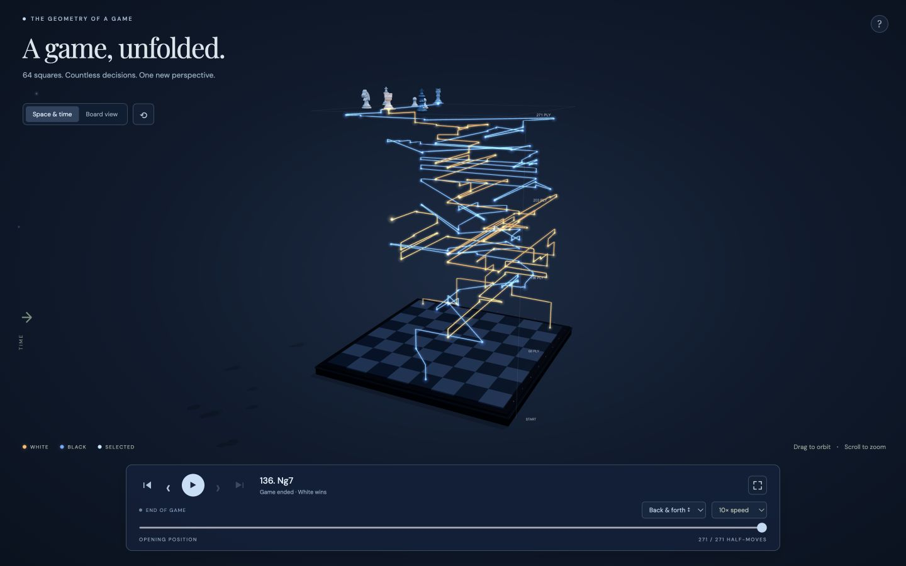

# Chess Atlas

A chess game, unfolded in 3D. Each piece leaves a glowing path through its positions, with height representing time. Select several pieces, compare both sides, and replay a game forward or backward.

**[Try the live site](https://superb-druid-37993a.netlify.app/)**



## Run locally

Install Node.js 18 or newer, then run these commands from the repository root:

```sh
npm start
```

Open **http://127.0.0.1:4173/** in a browser with WebGL support. No dependency installation or build is needed: Three.js and chess.js are bundled, with their licenses.

```sh
npm test
```

The application source, local server, tests, and detailed usage guide are in [`work/chess-atlas/`](work/chess-atlas/README.md). For a static host, publish `work/chess-atlas/dist/`. `netlify.toml` supplies that publish directory.

## Explore a game

- Import one game in standard PGN format. Games are parsed in your browser.
- Select pieces to compare their paths, or select a whole side. Isolate the selected paths for a clearer view.
- Choose one-color Moonlight paths or amber/blue paths for White and Black.
- Switch between Space & time and Board view, which projects the journeys onto the board.
- Step, scrub, or play continuously forward, backward, or back and forth, at up to 10× speed.
- Orbit, zoom, adjust timeline height and piece size, or expand the player to fullscreen.
- Captured pieces rest near their capture height; rewind to bring them back.

The Opera Game is built in. Historical game examples and legal generated simulations are also included below. Time means half-moves, not elapsed clock time.

## Screenshots, games, and downloads

- [Ten screenshots and captions](outputs/reddit-gallery/CAPTIONS.md), with [individual images](outputs/reddit-gallery/) and [five historical game PGNs](outputs/reddit-gallery/games/).
- [Screenshot collection ZIP](outputs/chess-atlas-reddit-screenshots.zip), including an HTML gallery. Extract it and open `reddit-gallery/index.html` locally to browse.
- [Standalone HTML version](outputs/chess-atlas.html): download the file and open it locally. The modular `dist/index.html` needs a web server.
- [Static hosting bundle](outputs/chess-atlas-hosting.zip).
- [Source archive](outputs/chess-atlas-source.zip), preserved alongside the current source in this repository.
- [Generated long endgame](outputs/long-endgame-example.pgn) and [260-move simulation](outputs/legal-260-move-simulation.pgn). These are visualization examples, not historical games or engine-best play.
- [Corrected supplied game](outputs/corrected-original-game.pgn) and [validated partial score](outputs/verified-game-through-28-Bg2.pgn).

Historical score sources are credited in the [screenshot captions](outputs/reddit-gallery/CAPTIONS.md). The preparation scripts and downloaded public scores are in `work/gallery-games/`. Run those scripts from the repository root. Run the endgame generators and standalone exporter from `work/chess-atlas/`.

## Project layout

```text
work/chess-atlas/       Application source, bundled libraries, server, tests, generators
work/gallery-games/    Public game scores and gallery preparation scripts
outputs/               Standalone app, hosting files, PGNs, screenshots, and download bundles
```

The optional Google Fonts stylesheet loads typefaces; system fonts are used if it is unavailable. The chess application otherwise uses its bundled assets.
